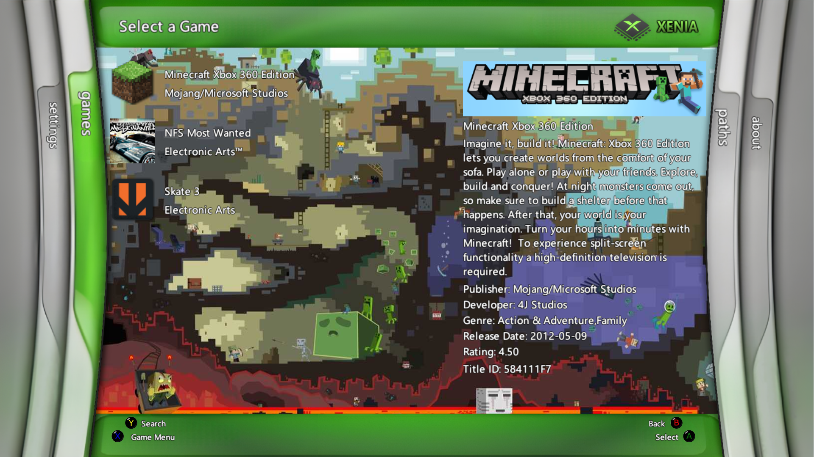

    

# Xenia Netplay UWP — tested on a real Series S devkit

> Fully vibe-coded, tested on hardware, and written up as it happened.
> See [FORK-STORY.md](FORK-STORY.md) for how this fork was born, and
> [#1](https://github.com/RaggedyBlueBox/xenia_uwp/issues/1) for the
> running engineering log.

**Status: Minecraft Xbox 360 Edition loads and plays.** The library
currently holds:

- **Minecraft Xbox 360 Edition** — boots, loads worlds, TU75 applies.
- **Need for Speed Most Wanted (2005)** — installed with English assets,
  in the library with full art.
- **Skate 3** — imported from disc, in the library with full art.

## What this fork adds

- **Minecraft world-load crash, fixed and proven.** Guest memory commits
  that Xbox silently rejects are committed read-write first, the
  executable code cache lives in private memory instead of dead section
  views, and the physical pre-commit was trimmed to save commit charge.
  Every step was measured with on-console probes —
  see [docs/xbox-probes/](docs/xbox-probes/).
- **A library that shows games, not system files.** Only bootable titles
  are listed; profiles, saves, caches, and title updates stay out.
- **Per-game plugin manager.** Enable/disable/delete patches and plugins
  per title, plus per-file online install backed by the live
  game-patches repo.
- **Headless title boot** for testing, achievements dialog that scrolls
  and closes on controller, and fixups ported from community forks
  (credited in commit messages).

## Install

Grab the signed sideload package from
[Releases](https://github.com/RaggedyBlueBox/xenia_uwp/releases), install
the certificate, and deploy to your devkit. Everything under this line is
the base project README, kept intact with credit.

---

# Xenia Canary for UWP

An unofficial UWP port of Xenia Canary, targeting Windows 10/11 desktop and
**Xbox One/Series X|S in Developer Mode**. It is not associated with the
Xenia or Xenia Canary developers, or with Microsoft.

This repository is a fork of
[danprice142/xenia-canary-uwp](https://github.com/danprice142/xenia-canary-uwp)
(the original UWP port), rebased onto current
[Xenia Canary](https://github.com/xenia-canary/xenia-canary), which is itself
an experimental fork of [Xenia](https://github.com/xenia-project/xenia). See
[Credits](#credits) below for the full chain.

## What's different in this fork

- Rebased the UWP port onto current Xenia Canary (~440 commits), including
  Xenia's move from Premake to CMake as its build system.
- The UWP app (`xenia-canary-uwp/`) now builds as part of the CMake solution
  via `include_external_msproject()`, instead of a separate, drifted build.
- Fixed the desktop CMake build (`xenia-app`), which had silently stopped
  working: `XE_PLATFORM_WINRT` was hardcoded to `1` for every build, routing
  desktop code through UWP-only paths with no diagnostic. See
  `src/xenia/base/platform.h` and `src/xenia/app/uwp_stubs_win.cc`.
- Added a small always-on ring buffer that logs the last N GPU draws when the
  device is lost, to help narrow down GPU hangs without needing PIX
  (`src/xenia/base/recent_draw_log.h`).
- Various crash fixes in the UWP-specific code: exception handling around the
  file/folder pickers and other `fire_and_forget` coroutines, a stack
  corruption bug in LIVE-signature title scanning, and cross-platform CRT
  fixes (`strncpy_s`/`localtime_s` guarded or replaced with portable
  equivalents) that had crept into shared code.

## Status

This is a hobby port, built and tested by one person against a handful of
titles. Expect rough edges. Desktop (Windows) and UWP (Xbox Dev Mode) Debug
and Release configurations all build and package successfully as of this
fork's latest commit.

## Building

The project uses CMake (see [docs/building.md](docs/building.md) for the
general Xenia build setup). The UWP app additionally requires:

- Visual Studio 2022+ with the **Universal Windows Platform development**
  workload.
- A code-signing certificate matching `Package.appxmanifest`'s
  `Identity Publisher` (generate your own self-signed one for local builds
  and sideloading; see `xenia-canary-uwp/`).

Deploying to an actual Xbox requires
[Developer Mode](https://learn.microsoft.com/en-us/windows/uwp/xbox-apps/devkit-activation)
and the Xbox Device Portal (Apps → Add, uploading both the `.appxbundle` and
its dependencies).

## Game compatibility

This fork tracks the same games as upstream Xenia Canary — see the
[official compatibility tracker](https://github.com/xenia-canary/game-compatibility/issues).

**For what's actually confirmed on this Xbox UWP port** — games tested
directly on real Xbox hardware, plus every title this port's own code
blocks — see [`docs/compatibility/uwp_compatibility_list.xlsx`](docs/compatibility/uwp_compatibility_list.xlsx).
It's a short list on purpose: nobody has run all 1,800+ titles on an
actual Xbox yet, so every other title is honestly marked "Untested on
UWP" rather than borrowing a PC status for it. Grows as real testing
comes in — see its Read Me sheet.

For a searchable/sortable snapshot merging the current Canary tracker with
the older pre-Canary one (1,800+ titles total), with the actual fix pulled
out of each game's discussion thread rather than just a checkbox, see
[`docs/compatibility/compatibility_list_v1.1.7.27.xlsx`](docs/compatibility/compatibility_list_v1.1.7.27.xlsx)
(includes a Legend sheet), or open
[`docs/compatibility/compatibility_list_v1.1.7.27.html`](docs/compatibility/compatibility_list_v1.1.7.27.html)
directly in a browser for the same data with in-page search/sort and no
spreadsheet program needed. `xenia-compatibility-ledger-v2.xlsx` is the
original unannotated bulk-imported ledger these are both generated from.
**This one's Status/Config columns are desktop PC Xenia Canary tracker
data, not verified on this Xbox UWP port** — treat it as a starting
reference, not a verdict; a title can (and does) play differently on Xbox
than what's listed (use `uwp_compatibility_list.xlsx` above for what's
actually confirmed). Real-device findings from actual Xbox testing are
tracked separately in
[`docs/compatibility/KNOWN_ISSUES.md`](docs/compatibility/KNOWN_ISSUES.md),
which also explains why.
The UWP/Xbox build only has the Direct3D 12 backend available (no native
Vulkan driver on Xbox), so titles whose only known fix is switching to
Vulkan are blocked from launching entirely, with an explanation, rather
than being allowed to hang or render incorrectly — see
`EmulatorWindow::RunTitle`'s `kVulkanRequiredTitleIds` and the "Blocked"
section of `KNOWN_ISSUES.md` for the full, named list.

## Credits

- [Xenia](https://github.com/xenia-project/xenia) — the original Xbox 360
  emulator project.
- [Xenia Canary](https://github.com/xenia-canary/xenia-canary) — the
  experimental fork this port tracks.
- [danprice142/xenia-canary-uwp](https://github.com/danprice142/xenia-canary-uwp) —
  the original UWP/Xbox port this fork is based on.

## Disclaimer

The goal of this project is to experiment, research, and educate on the topic
of emulation of modern devices and operating systems. **It is not for enabling
illegal activity**. All information is obtained via reverse engineering of
legally purchased devices and games and information made public on the internet
(you'd be surprised what's indexed on Google...).
